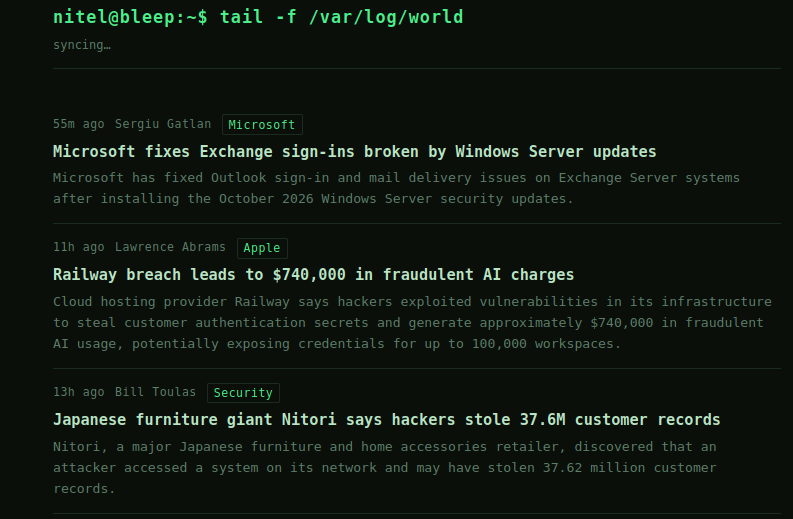

# Cogno Hacker News

A lightweight, self-updating cybersecurity news page. It pulls the latest stories from the [BleepingComputer](https://www.bleepingcomputer.com/feed/) RSS feed and serves them on a fast, dark terminal-style page — no database, no build step.

Live: [cogno.ir](https://cogno.ir)



## Features

- Server-rendered page — news shows instantly, even without JavaScript
- Auto-sync every 12 h (server), silent refresh every 5 min (browser)
- Stale-cache fallback: the page never goes blank when the feed is unreachable
- Minimal stack: FastAPI + requests, zero extra dependencies

## Run

```bash
docker build -t cogno-news . && docker run -p 8000:8000 cogno-news
```

or locally:

```bash
uvicorn main:app --reload
```

Config via env: `PORT` (default `8000`), `CACHE_FILE` (optional path to persist the news cache across restarts).

## Endpoints

| Path        | Description    |
| ----------- | -------------- |
| `/`         | news page      |
| `/api/news` | feed as JSON   |
| `/health`   | liveness check |
